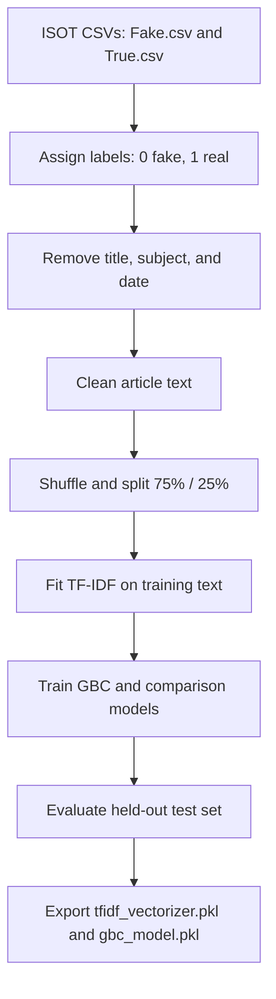
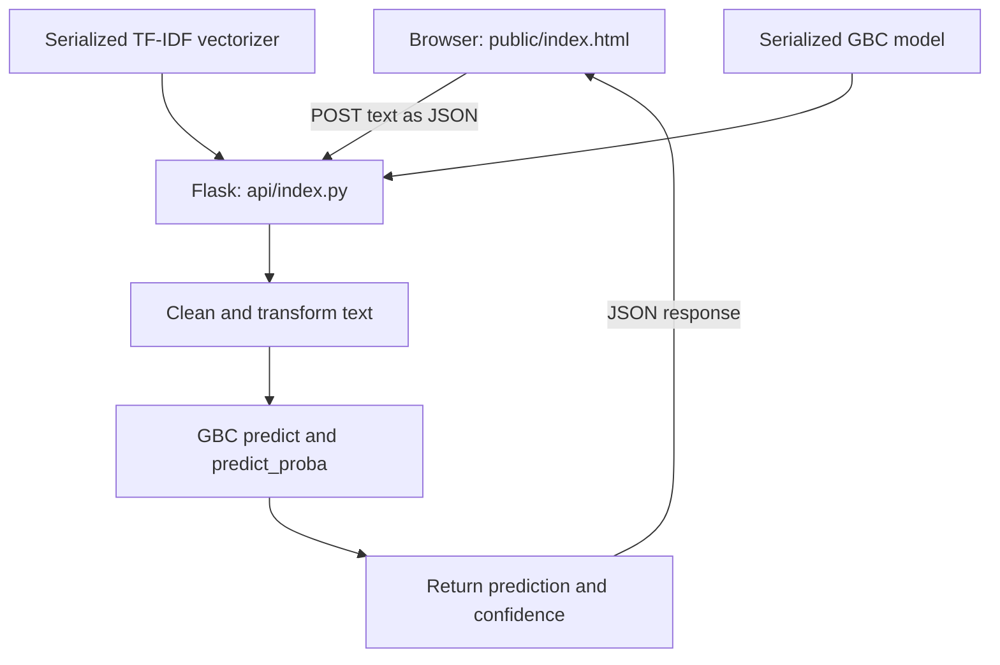

# News Credibility Classification Engine

This undergraduate thesis project investigates binary classification of news text with the ISOT Fake and Real News dataset. It assigns each article body to either `Fake News` or `Not A Fake News` using a TF-IDF representation and a Gradient Boosting Classifier (GBC). The repository contains the reproducible notebook used for data preparation and model comparison, serialized inference artifacts, a Flask prediction API, and a static browser interface deployed through Vercel.

**Live Demo:** [news-credibility-classifier.vercel.app](https://news-credibility-classifier.vercel.app/)

The deployed model receives article text only. Article metadata is excluded from training and inference: the notebook removes `title`, `subject`, and `date` before TF-IDF fitting, preventing publication source, category, or date cues from becoming available as direct features. The system is designed for the ISOT classification setting and should be interpreted as a text-style classification study rather than a general fact-checking or source-verification service.

## System Overview

The repository separates model development from runtime inference:

1. `Fake.csv` and `True.csv` are loaded and assigned binary labels (`0` for fake, `1` for true).
2. The notebook removes the final 10 rows from each source file for manual testing, concatenates the remaining records, removes `title`, `subject`, and `date`, shuffles the rows, and creates a 75/25 train/test split.
3. A `TfidfVectorizer` is fitted on training text and transforms the held-out test text. The serialized vectorizer has a 95,396-term vocabulary.
4. Logistic Regression, Decision Tree, Random Forest, and Gradient Boosting classifiers are trained and evaluated. The serialized GBC is the runtime model.
5. The Flask endpoint loads both serialized artifacts, cleans submitted text, transforms it, predicts a class, and returns JSON.
6. The static interface sends the text to `/api/predict` and displays the label and model-provided class probability.

### Training and evaluation



### Browser inference



## Data and Leakage Controls

The repository contains both ISOT CSV partitions:

| Split file | Rows | Columns | Missing values |
|---|---:|---|---:|
| `Fake.csv` | 23,481 | `title`, `text`, `subject`, `date` | 0 |
| `True.csv` | 21,417 | `title`, `text`, `subject`, `date` | 0 |

The model does not use `title`, `subject`, or `date`. The notebook's manual-test partitions also remove only the final 10 rows from each data frame. Remaining content is shuffled before splitting; the class labels are derived entirely from the source CSV partition (`Fake.csv = 0`, `True.csv = 1`).

The notebook applies lowercase conversion, bracket removal, URL removal, HTML-tag removal, whitespace/newline normalization, and removal of punctuation and digit-containing tokens. At runtime, `api/index.py` uses the same lowercase, bracket, non-word, URL, HTML, and newline operations, but it does not remove punctuation through the second replacement or remove digit-containing tokens. Accordingly, the browser/API preprocessing is slightly less restrictive than notebook preprocessing. This difference should be resolved before making strong production or cross-dataset claims from new inputs.

## Text Representation and Model

`TfidfVectorizer` converts each cleaned article body into a sparse term-frequency/inverse-document-frequency matrix. Default scikit-learn vectorizer settings are used in the notebook; no n-gram range or explicit stop-word list is configured. The fitted vectorizer contains 95,396 vocabulary features.

The deployed `GradientBoostingClassifier` is configured in the notebook with `random_state=42` and is serialized through Joblib as `gbc_model.pkl`. Inspection of the serialized artifact also shows 100 estimators, a learning rate of `0.1`, and 95,396 input features.

The served API computes `predict_proba` for each class and reports `max(probabilities) * 100`, rounded to one decimal place. Because the implementation uses GBC, `predict_proba` is available. The API fallback branch for a model without probability support is present in code, but the deployed GBC has the required method.

## Evaluation

The notebook reserves 25% of the prepared data for testing and trains on 75%. The executed notebook reports the following held-out classification reports:

| Model | Accuracy | Fake precision / recall / F1 | Real precision / recall / F1 | Test support |
|---|---:|---|---|---:|
| Logistic Regression | 0.99 | 0.99 / 0.98 / 0.99 | 0.98 / 0.99 / 0.99 | 11,220 |
| Decision Tree | 1.00 | 1.00 / 1.00 / 1.00 | 1.00 / 1.00 / 1.00 | 11,220 |
| Gradient Boosting | 1.00 | 1.00 / 1.00 / 1.00 | 1.00 / 1.00 / 1.00 | 11,220 |
| Random Forest | 0.99 | 0.99 / 0.99 / 0.99 | 0.99 / 0.99 / 0.99 | 11,220 |

The support table has 5,902 fake-news examples and 5,318 true-news examples. Accuracy is the fraction of test articles assigned to the correct class. Precision measures the fraction of positive predictions that match the label; recall measures the fraction of labeled examples detected; F1 is the harmonic mean of precision and recall.

The static interface also displays benchmark percentages (`98.6%`, `98.1%`, `95.1%`, `92.5%`) and identifies GBC as deployed. Those values are visual presentation labels rather than metrics reproduced by the executed notebook cells; the notebook's report output is the numerical evidence retained in the repository.

The train/test split in the notebook does not set a random seed. Although the tree and ensemble classifiers set `random_state=42`, exact rerunning of the split is not guaranteed. The notebook therefore records model training reproducibility, but not a fully deterministic train/test partition.

## API Behavior

### Endpoint

`POST /api/predict`

Request:

```json
{
  "text": "Article body or headline text"
}
```

Successful response:

```json
{
  "prediction": "Not A Fake News",
  "confidence": 99.1,
  "status": "success"
}
```

The API uses these HTTP outcomes:

- `200`: a non-empty text value was transformed and classified.
- `400`: `text` is missing or contains only whitespace.
- `500`: model loading, JSON processing, transformation, or prediction failed; the response contains the exception text.

The browser displays `Not A Fake News` as "Authentic / Real News" and `Fake News` as "Potential Unverified / Fake News." These UI phrases are presentation labels: the model performs binary ISOT-style classification and does not independently verify facts or claims.

## Repository Structure

| Path | Purpose |
|---|---|
| `news-credibility.ipynb` | Data loading, metadata removal, preprocessing, train/test split, model comparison, artifact export, and inference examples. |
| `Fake.csv` | ISOT fake-news partition with 23,481 rows. |
| `True.csv` | ISOT true-news partition with 21,417 rows. |
| `tfidf_vectorizer.pkl` | Fitted 95,396-feature TF-IDF vectorizer. |
| `gbc_model.pkl` | Serialized 100-estimator Gradient Boosting classifier. |
| `api/index.py` | Flask app and `/api/predict` endpoint. |
| `public/index.html` | Static interface with sample articles, word count, request handling, and result rendering. |
| `vercel.json` | Vercel Python/static build and route configuration. |
| `requirements.txt` | Flask, scikit-learn, and Joblib runtime dependencies. |
| `run_project.bat` | Existing Windows helper that activates `.venv` and opens Jupyter Notebook. |

## Local Setup

The project has no required API key or environment variable. It uses only the locally serialized vectorizer and classifier. It does not call an external model API, and no network fallback is implemented.

### Windows PowerShell

Run from the repository root:

```powershell
python -m venv .venv
.\.venv\Scripts\Activate.ps1
python -m pip install --upgrade pip
python -m pip install -r requirements.txt
```

Start the Flask API:

```powershell
python -m flask --app api/index.py run --port 5000
```

Test the endpoint in a second PowerShell window:

```powershell
$body = @{ text = "WASHINGTON (Reuters) - The Senate passed legislation today." } | ConvertTo-Json
Invoke-RestMethod -Uri "http://127.0.0.1:5000/api/predict" -Method Post -ContentType "application/json" -Body $body
```

Open the notebook from the repository root:

```powershell
python -m pip install jupyter
python -m jupyter notebook news-credibility.ipynb
```

### macOS and Linux

```bash
python3 -m venv .venv
source .venv/bin/activate
python -m pip install --upgrade pip
python -m pip install -r requirements.txt
python -m flask --app api/index.py run --port 5000
```

Test in a second terminal:

```bash
curl -X POST http://127.0.0.1:5000/api/predict \
  -H "Content-Type: application/json" \
  -d '{"text":"WASHINGTON (Reuters) - The Senate passed legislation today."}'
python -m pip install jupyter
python -m jupyter notebook news-credibility.ipynb
```

### Static interface

```bash
python -m http.server 5500 --directory public
```

Open `http://127.0.0.1:5500/`. The browser calls `/api/predict` on the page's origin, so local use requires routing that path to port 5000 or changing the fetch URL to `http://127.0.0.1:5000/api/predict`.

Run the notebook cells from top to bottom to rebuild both Joblib artifacts.

There is no automated unit-test suite or test command in the repository. Validation currently consists of the executed notebook's held-out classification reports and manual `curl` or PowerShell requests against `/api/predict`.

## Vercel Deployment

`vercel.json` routes:

- `/api/predict` to `api/index.py` using `@vercel/python`.
- Other routes to files under `public/` using `@vercel/static`.

After installing the Vercel CLI and authenticating, deploy from the repository root:

```bash
npm install -g vercel
vercel
vercel --prod
```

Vercel deploys the same local pickle artifacts. The runtime therefore needs the serialized files at the repository root and the dependencies listed in `requirements.txt`.

## Scope and Limitations

- Predictions are based on the wording and style of ISOT article text; they are not evidence of factual correctness.
- The class distributions and vocabulary reflect the supplied dataset and may not transfer to current news, other languages, satire, opinion, or domains outside the training corpus.
- The notebook removes source metadata, but document duplicates, shared boilerplate, or temporal and editorial patterns may still encode dataset-specific structure not visible as explicit `title`, `subject`, or `date` features.
- The notebook and API currently contain a preprocessing mismatch for punctuation and digit-containing tokens.
- The train/test split is not explicitly seeded, so exact partition-dependent metric reruns require updating the split call to include a fixed `random_state`.
- No automated tests, calibration analysis, confusion matrix export, or cross-validation procedure is included in the repository.
- `predict_proba` is returned as a confidence score, but this is model class probability, not an external estimate of factual truth or confidence in real-world news verification.
